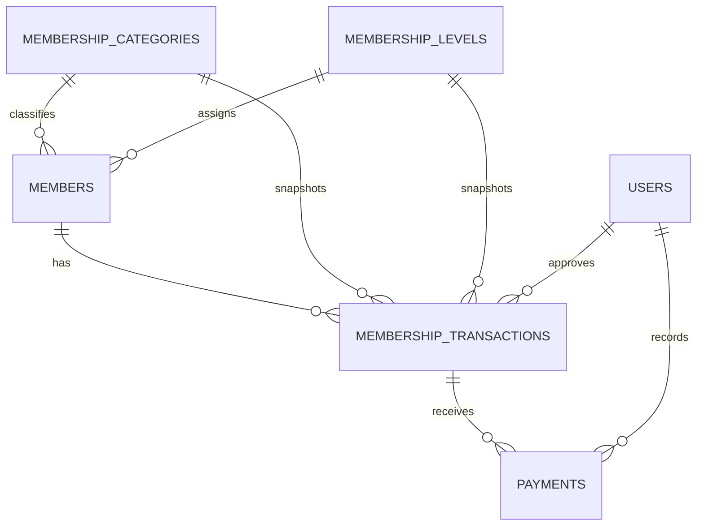

# LooksMaxxing Fitness Academy

Gym membership management for Tondo, Manila. PHP 8.4, Laravel 13, Blade, and MySQL 8. Currency is PHP; application timezone is Asia/Manila. Target submission: November 25, 2026, 11:59 PM (UTC+8). All hosting and integrations must stay on free plans.

## Current checkpoint

Completed: MySQL schema and models, seed plans and discounts, transactional membership service, administrator authentication, public membership landing page, and overview dashboard.

Not yet completed: member/category/level CRUD screens, public application form, payment/renewal screens, printable receipts, live maps/weather/email, and public deployment. The transaction service is tested independently of those future screens. Do not present this checkpoint as the completed project.

EthioDeploy Free is the deployment target. Its account still needs to be created by the owner. No remote repository or deployment has been created.

## Local preview in this workspace

Run `./Start-Local.ps1` from PowerShell. This uses the project-local PHP and MySQL runtimes in `../../work/runtime`, without changing XAMPP. Open http://127.0.0.1:8000. Local sign-in details are in `LOCAL_ACCESS.txt`, which is excluded from Git.

The server binds only to 127.0.0.1. It is for local development.

## Standard installation

1. Install PHP 8.3+ with pdo_mysql, mbstring, intl, openssl, curl, fileinfo, XML, and zip, plus Composer.
2. Run `composer install`.
3. Copy `.env.example` to `.env` and enter your MySQL connection details.
4. Create an empty MySQL database named `looksmaxxing`.
5. Run `php artisan key:generate` and `php artisan migrate --seed`.
6. Run `php artisan looksmaxxing:admin your-email@example.com` and enter a password. There is no shared production password or public administrator registration.
7. Run `php artisan serve`.

Styles are served directly from `public/css/app.css`. The scaffold's Vite build is also supported with `npm ci && npm run build`.

## Plans and discounts

| Level | Price | Validity | Benefits |
|---|---:|---|---|
| Basic | PHP 700 | 30 days | Strength equipment |
| Silver | PHP 1,000 | 30 days | Strength and cardio equipment |
| Gold | PHP 1,500 | 30 days | All equipment and group classes |
| Platinum | PHP 2,500 | 30 days | Gold benefits and four coaching sessions |

Categories: Regular 0%, Student 10%, Senior Citizen 20%, Corporate 15%. These are demonstration policies. Classes and coaching sessions are plan descriptions; scheduling is outside the first version. Seeding is safe to repeat and preserves edited prices.

## Database design

Six core tables, including users, plus Laravel's supporting session, cache, password reset, and queue tables:

- `users`: hashed password, administrator flag. Non-administrators cannot sign in to staff screens.
- `membership_categories`: unique name, integer discount percentage, active flag.
- `membership_levels`: unique name, fee in integer centavos, validity days, JSON benefit descriptions, active flag.
- `members`: unique membership number and email, category and level foreign keys, contact information, optional coordinates, activation/expiry dates, deactivation flag.
- `membership_transactions`: unique reference, member/category/level foreign keys, application or renewal, status, immutable price/category/level/discount/validity snapshots, payment due date, approval actor and period.
- `payments`: unique receipt, valid transaction foreign key, integer-centavo amount, method, unique external reference when provided, timestamp, recording administrator.

## Business rules

- Money is stored in integer centavos to avoid floating-point addition errors. One category discount applies, rounded half-up to the nearest centavo.
- Category/level selection must be active. A member has only one pending or paid transaction at a time.
- Pending -> Paid -> Approved. A full payment alone does not activate membership; administrator approval does.
- Cash, GCash, and bank transfer are recorded manually. GCash and bank transfer require a reference.
- Partial payments are supported. Zero, negative, excess, and duplicate referenced payments are rejected.
- Only fully paid transactions can be approved. Row locks and database transactions prevent repeated approval and inconsistent balances.
- Approval starts a new 30-day period. Active renewals extend the existing expiry; expired memberships restart on approval.
- Unpaid pending transactions can be cancelled. Transactions containing recorded payments cannot be cancelled without a future refund workflow.
- Unpaid transactions expire after seven days. Partially paid records stay pending and can still be settled after that deadline.
- Old approved transactions remain approved when membership expires. A member's current expiry is calculated separately from the financial history.
- Foreign keys restrict deleting records that are used by financial history. Use member deactivation to retain history.

## Tests

Tests use real MySQL, never SQLite. Create a separate database named `looksmaxxing_testing`, create `.env.testing` with its credentials and a separate APP_KEY, then run `php artisan test --compact`. The test bootstrap refuses to run against another database.

In this prepared workspace, both databases are already configured. Use the portable PHP in `../../work/runtime/php` for Artisan.

Verified at this checkpoint: 28 tests and 94 assertions pass against MySQL; the frontend build succeeds; desktop and 390-pixel mobile browser checks pass, including administrator sign-in and sign-out, with no JavaScript errors or horizontal page overflow. Preview screenshots are saved in the parent outputs folder.

## Deployment and integrations still to verify

- EthioDeploy Free: add its MySQL addon and set DB_CONNECTION=mysql. Laravel reads DATABASE_URL through the configured fallback.
- Use APP_ENV=production, APP_DEBUG=false, the HTTPS APP_URL, and SESSION_SECURE_COOKIE=true. Configure only the host's verified proxy settings during deployment.
- Run migrations and safe seed data before serving traffic. Create the production administrator privately with the CLI command.
- Run the database queue worker inside the app container. It pauses when the free host sleeps.
- Google Maps Demo Key: eligible personal account, demonstration/prototype use only, no billing.
- OpenWeather Current Weather free access: keep the key on the server, cache results, validate coordinates, and rate-limit requests.
- Brevo free HTTPS API: verify the sender, preserve queued after-commit dispatch, and test actual delivery before calling email complete.
- Never commit .env, .env.testing, LOCAL_ACCESS.txt, or API keys. No paid upgrades or billing-enabled services.
