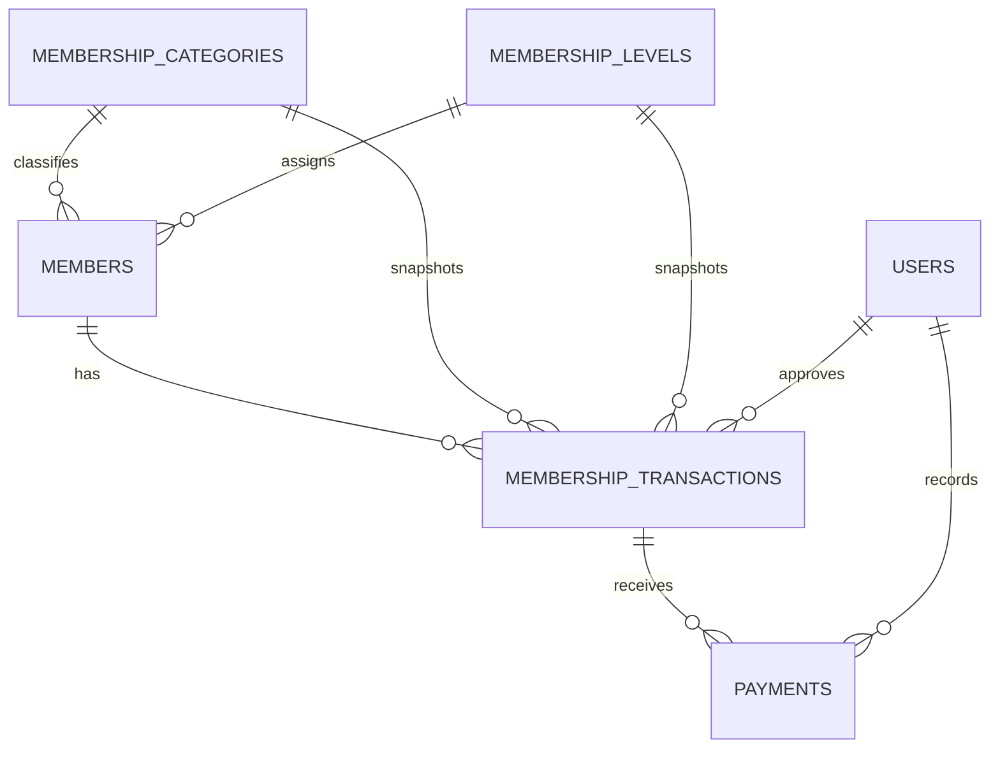

# LooksMaxxing Fitness Academy

Gym membership management for Tondo, Manila. PHP 8.4, Laravel 13, Blade, and MySQL 8. Currency is PHP; application timezone is Asia/Manila. Target submission: November 25, 2026, 11:59 PM (UTC+8). All hosting and integrations must stay on free plans.

## Current checkpoint

Completed: MySQL schema and models, seeded plans/discounts, transactional membership service, administrator authentication, public landing page/application form, member registration/search/edit/deactivation/reactivation, category/level management, payment recording, approval, renewals, transaction history, and printable payment records. Responsive styles and form interactions are integrated.

Still pending: configure and verify the actual Google Maps Demo, OpenWeather, and Brevo keys; verify production staff login and the updated deployed workflow. The integration adapters are implemented and tested with controlled provider responses; that does not verify real email delivery or live API access.

EthioDeploy Free is the deployment target. The private GitHub source repository is https://github.com/jehocsh/looksmaxxing-fitness-academy (deployed branch: main). The public address is https://looksmaxxing-fitness-academy.ethiodeploy.app. On November 25 the owner confirmed the project is live, the free MySQL addon is added, and production settings are saved. An HTTP check returned 200 with the LooksMaxxing page; the latest screen changes still need uploading and deployment verification.

### November 25 resume update

- The user explicitly resumed development. The old pause instructions below are historical.
- Use `exec_command` with `require_escalated`: the normal Windows runner still fails with error 1920, while the alternate runner works. File edits through `apply_patch` work too. No need to repeat the earlier blocked-access loop.
- Wired the dashboard into the admin layout; added public plan/application links, responsive admin/forms/catalog/print styles, discounted fee preview, optional coordinates/clear action, Google Maps callback, weather widget, confirmation prompts, and print action.
- Expired unpaid applications are refreshed on dashboard, transaction, and profile reads. Existing inactive category/level assignments can be retained when editing contact details. Open transactions prevent changing the member's plan.
- Added a unique nullable `payments.submission_token` migration. Payment forms carry a UUID; replaying a submitted cash/transfer form returns its existing receipt. A different payload with the same form token is rejected. Duplicate transfer references return a validation error.
- Replaced the two generated test stubs with actual HTTP and integration coverage. Current complete MySQL suite: 57 tests, 277 assertions passed. Frontend production build and formatting passed. Desktop and 390px mobile browser checks passed with zero JavaScript errors, including live fee quotes, optional coordinate clearing, staff registration, payment, approval, receipt printing, and renewal. Screenshots and a sample receipt PDF are in the parent outputs folder. Browser checks created clearly named Demo Member records with example.test emails in the local database only.
- The owner confirmed NO map/weather/email keys are configured yet and needs setup instructions. Guide them through free accounts and private EthioDeploy Env Vars; never ask for keys in chat. Use the Google Maps Demo Key (personal Google account, no billing) for the academic prototype, OpenWeather's free Current Weather API, and Brevo Free with a verified sender.
- Production first-admin configuration still needs confirmation: ADMIN_EMAIL and ADMIN_PASSWORD (minimum 12 characters) privately in host settings. Existing admins are not overwritten by bootstrap.

## Historical November 24 checkpoint

## PAUSED: resume checkpoint (November 24, 2026)

The user previously requested STOP because their usage was running out, then explicitly resumed on November 25. Their deadline is November 25, 2026 at 11:59 PM, Manila time (UTC+8). The following notes retain the earlier setup history; the current checkpoint above takes precedence.

### Agreed product and constraints

- Gym name: LooksMaxxing, subtitle Fitness Academy. Location: Tondo, Manila, area only; no street address was provided. Currency: PHP.
- Palette reference: blue, charcoal, red, off-white, orange. Current CSS uses #4756d7, #211d1b, #ee3537, #eeedeb, #e9831c respectively.
- Strict zero spending. Free plans only. MySQL is mandatory; do not switch to PostgreSQL or MariaDB. Render and Aiven were considered and superseded by EthioDeploy Free with its included MySQL addon.
- Public gym site and application form, plus administrator login/dashboard. No member portal, online payment gateway, class booking, or coaching scheduling was requested. Payments are manual staff records for cash, GCash, and bank transfer.
- Four 30-day plans: Basic PHP700 (strength equipment), Silver PHP1000 (strength/cardio), Gold PHP1500 (all equipment/group classes), Platinum PHP2500 (Gold benefits/four coaching sessions). Benefits are descriptions.
- Category discounts: Regular 0%, Student 10%, Senior Citizen 20%, Corporate 15%; one category per member and no stacked discounts. Preserve financial snapshots. Membership starts after full payment and administrator approval; active renewals extend the current expiry and expired memberships restart on approval.
- Integrations planned: Google Maps Demo Key (eligible personal Google account, prototype use only, no billing), OpenWeather free Current Weather via Laravel, Brevo Free HTTPS transactional email with a database queue dispatched after commit. Actual API keys/sender verification have NOT been supplied or tested.
- Tondo area center was obtained from OpenStreetMap Nominatim: latitude 14.6189095, longitude 120.9660386. It is an area center, not an exact gym location.

### What is verified and uploaded

- Repository initialized on local branch codex/looksmaxxing-foundation, tracking origin/main. Private GitHub repository was created using the computer's existing authorized GitHub sign-in (account jehocsh). Never display Git credentials.
- Commit 94659f0: verified foundation, including six core tables, models, factories, plan/category seed data, transactional membership service, staff authentication, landing page, and overview dashboard.
- Commit 8171a4d: free EthioDeploy startup script, private first-administrator bootstrap, production HTTPS URL generation, gym config, and environment placeholders. Both commits were pushed to remote main.
- Last COMPLETE verified suite before new screen work: 28 tests / 94 assertions passed on actual MySQL. A later narrow foundation run passed 26 tests / 92 assertions before the latest unverified screen changes.
- Frontend npm build passed, with no dependency vulnerabilities reported. Browser checks of the foundation passed sign-in, logout, and 390-pixel mobile overflow checks; zero page errors. Four screenshots are in the parent outputs folder: looksmaxxing-desktop.png, looksmaxxing-mobile.png, looksmaxxing-login.png, looksmaxxing-dashboard.png.

### Hosting handoff: exact last user step

1. User created EthioDeploy account through GitHub and selected jehocsh/looksmaxxing-fitness-academy, branch main, Web Service, Builder Auto, repository root. They were told to clear custom install/build commands and set Start Command to sh start-ethiodeploy.sh.
2. User's screenshot showed the project building from 8171a4d at the public address above.
3. User was instructed to add the included Free / 512MB MySQL addon under Addons. Actual creation/readiness has NOT been confirmed.
4. User asked whether to add APP_URL under Env Vars. They were told to use https://looksmaxxing-fitness-academy.ethiodeploy.app and responded OK; the saved host setting was not independently inspected.
5. LAST INSTRUCTION before pause: in Env Vars add APP_ENV=production, APP_DEBUG=false, DB_CONNECTION=mysql, SESSION_SECURE_COOKIE=true, QUEUE_CONNECTION=database, and save. The user has NOT confirmed completing these five entries.
6. NEXT HOSTING STEP: guide them to add ADMIN_EMAIL and ADMIN_PASSWORD privately in EthioDeploy (minimum 12-character password), then save/redeploy after verifying the MySQL addon. Do not ask them to paste secrets. Database connection details come from the addon-provided DATABASE_URL, already supported by config/database.php.
7. Production administrator initialization is handled by looksmaxxing:bootstrap-admin in the startup script, only when no administrator exists. It does not reset an existing password. The bootstrap password can be removed from host settings after setup.
8. Public website availability, production MySQL, staff login, worker operation, and live API delivery all remain unverified.

### Unfinished local work saved at pause (NOT deployed)

The next work batch was written but NOT fully integrated, tested, or pushed. A local-only WIP checkpoint follows 8171a4d. Do NOT push it until finished and tested.

- Controllers: ApplicationController, MemberController, CategoryController, LevelController, TransactionController, PaymentController, WeatherController.
- Validation requests: StoreApplicationRequest, StoreMemberRequest, StoreCategoryRequest, StoreLevelRequest, StorePaymentRequest.
- Routes expanded to 32 verified route registrations: public application/weather; member CRUD/reactivation/renewal/reapplication; category/level CRUD; transaction list/detail/approval/cancellation/printable record; payment recording.
- MembershipService gained a centavo parsing helper; its original business rules remain in place.
- Queued MembershipApplicationSubmitted notification, custom BrevoChannel, email Blade template, and config/services.php entries were written. OpenWeather controller has coordinate validation, cache, timeout, restricted response fields, and friendly failure handling. Actual execution of these new integrations is untested.
- New Blade views: layouts/admin, membership/apply, membership/fields, membership/location, admin member index/form/profile, category/level management, transaction index/table/detail/receipt, email application acknowledgment.
- STILL MISSING: public/js/app.js and its inclusion in layouts/site; the @stack('scripts') slot for Google Maps; quote preview/map/weather/confirmation/print interactions; CSS for the new admin/forms/catalog/receipt/location classes; dashboard conversion to layouts/admin; homepage links to apply and location widget integration.
- IntegrationTest.php and MembershipScreensTest.php are only GENERATED STUBS. They must be replaced with meaningful tests; their existence is NOT evidence of coverage.
- Review active/inactive category validation for existing members, transaction expiry when opening detail/profile, payment duplicate handling, mobile layouts, print layout, and new form behavior. Add tests before declaring the next batch complete.
- README's general Completed/Not yet completed paragraphs describe the VERIFIED foundation; the unfinished batch above is only partial progress.

### Local environment and restart information

- Workspace: C:/Users/Josh/Documents/Codex/2026-11-24/ok-x20. App: outputs/looksmaxxing. Scratch/runtime helpers: work/.
- Existing XAMPP PHP is 8.2.12 and was not changed. Downloaded verified portable PHP 8.4.28 under work/runtime/php and official MySQL 8.4.13.1 under work/runtime/mysql-8.4.13.1-winx64. These are free project-local tools, not global installs.
- MySQL binds only to 127.0.0.1:3307. Application database looksmaxxing; separate test database looksmaxxing_testing. TestCase refuses to run on another engine/database.
- Development preview binds to http://127.0.0.1:8000. Both local servers were still running at pause. Restart through outputs/looksmaxxing/Start-Local.ps1 if needed.
- Private values are in .env, .env.testing, and LOCAL_ACCESS.txt (all ignored by Git). MySQL local initialization credentials are in work/runtime/database-local.json. Do not print them, commit them, or reuse the local administrator password in production.
- Use work/runtime/php/php.exe for Artisan and Composer. Composer PHAR: C:/ProgramData/ComposerSetup/bin/composer.phar. npm.cmd is installed. Current app dependencies are installed under vendor and node_modules (ignored).
- Read AGENTS.md in the app before edits. Laravel Boost was installed as required by generated project instructions. Testing guidance is under vendor/laravel/boost/.ai/laravel/skill/testing-best-practices/.
- Standard process tools and node_repl fail with CreateProcessWithLogonW error 1920 in this session. exec_command with require_escalated works. apply_patch works. The browser-control tool failed twice; the GitHub connector is disabled by admin. User is doing hosting UI steps while code work continues. Use Git/Git Credential Manager for authorized repository operations; never log credential values.
- Automatic approval rejected globally trusting arbitrary reverse proxies. That setting was removed. The current startup retains Laravel's default proxy trust and AppServiceProvider forces HTTPS URL generation only in production. Do not restore global proxy trust as a workaround.
- Headless local visual checks use the already bundled Playwright package and installed Edge via work/check-preview.cjs. Adapt it once new screens are integrated. This helper is outside the source repository.

### Resume order

First read this checkpoint and git status; honor the user's pause until explicitly resumed. Then finish the new screen wiring/styles/JavaScript, replace test stubs, run meaningful MySQL feature tests and browser checks, and only then push the completed next batch to main. Continue helping the user finish the hosting Env Vars/MySQL/admin setup, verify the actual public site, then obtain free API credentials through private configuration and verify map/weather/email. Finish documentation, screenshots, and rubric checks before the deadline.

## Local preview in this workspace

Run `./Start-Local.ps1` from PowerShell. This uses the project-local PHP and MySQL runtimes in `../../work/runtime`, without changing XAMPP. Open http://127.0.0.1:8000. Local sign-in details are in `LOCAL_ACCESS.txt`, which is excluded from Git.

The server binds only to 127.0.0.1. It is for local development.

## Standard installation

1. Install PHP 8.3+ with pdo_mysql, mbstring, intl, openssl, curl, fileinfo, XML, and zip, plus Composer.
2. Run `composer install`.
3. Copy `.env.example` to `.env` and enter your MySQL connection details.
4. Create an empty MySQL database named `looksmaxxing`.
5. Run `php artisan key:generate` and `php artisan migrate --seed`.
6. Run `php artisan looksmaxxing:admin your-email@example.com` and enter a password. There is no shared production password or public administrator registration.
7. Run `php artisan serve`.

Styles are served directly from `public/css/app.css`. The scaffold's Vite build is also supported with `npm ci && npm run build`.

## Plans and discounts

| Level | Price | Validity | Benefits |
|---|---:|---|---|
| Basic | PHP 700 | 30 days | Strength equipment |
| Silver | PHP 1,000 | 30 days | Strength and cardio equipment |
| Gold | PHP 1,500 | 30 days | All equipment and group classes |
| Platinum | PHP 2,500 | 30 days | Gold benefits and four coaching sessions |

Categories: Regular 0%, Student 10%, Senior Citizen 20%, Corporate 15%. These are demonstration policies. Classes and coaching sessions are plan descriptions; scheduling is outside the first version. Seeding is safe to repeat and preserves edited prices.

## Database design

Six core tables, including users, plus Laravel's supporting session, cache, password reset, and queue tables:

- `users`: hashed password, administrator flag. Non-administrators cannot sign in to staff screens.
- `membership_categories`: unique name, integer discount percentage, active flag.
- `membership_levels`: unique name, fee in integer centavos, validity days, JSON benefit descriptions, active flag.
- `members`: unique membership number and email, category and level foreign keys, contact information, optional coordinates, activation/expiry dates, deactivation flag.
- `membership_transactions`: unique reference, member/category/level foreign keys, application or renewal, status, immutable price/category/level/discount/validity snapshots, payment due date, approval actor and period.
- `payments`: unique receipt, valid transaction foreign key, integer-centavo amount, method, unique external reference when provided, timestamp, recording administrator.

## Business rules

- Money is stored in integer centavos to avoid floating-point addition errors. One category discount applies, rounded half-up to the nearest centavo.
- Category/level selection must be active. A member has only one pending or paid transaction at a time.
- Pending -> Paid -> Approved. A full payment alone does not activate membership; administrator approval does.
- Cash, GCash, and bank transfer are recorded manually. GCash and bank transfer require a reference.
- Partial payments are supported. Zero, negative, excess, and duplicate referenced payments are rejected.
- Only fully paid transactions can be approved. Row locks and database transactions prevent repeated approval and inconsistent balances.
- Approval starts a new 30-day period. Active renewals extend the existing expiry; expired memberships restart on approval.
- Unpaid pending transactions can be cancelled. Transactions containing recorded payments cannot be cancelled without a future refund workflow.
- Unpaid transactions expire after seven days. Partially paid records stay pending and can still be settled after that deadline.
- Old approved transactions remain approved when membership expires. A member's current expiry is calculated separately from the financial history.
- Foreign keys restrict deleting records that are used by financial history. Use member deactivation to retain history.

## Tests

Tests use real MySQL, never SQLite. Create a separate database named `looksmaxxing_testing`, create `.env.testing` with its credentials and a separate APP_KEY, then run `php artisan test --compact`. The test bootstrap refuses to run against another database.

In this prepared workspace, both databases are already configured. Use the portable PHP in `../../work/runtime/php` for Artisan.

Verified at this checkpoint: 28 tests and 94 assertions pass against MySQL; the frontend build succeeds; desktop and 390-pixel mobile browser checks pass, including administrator sign-in and sign-out, with no JavaScript errors or horizontal page overflow. Preview screenshots are saved in the parent outputs folder.

## Deployment and integrations still to verify

- EthioDeploy Free: add its MySQL addon and set DB_CONNECTION=mysql. Laravel reads DATABASE_URL through the configured fallback.
- Use APP_ENV=production, APP_DEBUG=false, the HTTPS APP_URL, and SESSION_SECURE_COOKIE=true. Configure only the host's verified proxy settings during deployment.
- Run migrations and safe seed data before serving traffic. Create the production administrator privately with the CLI command.
- Run the database queue worker inside the app container. It pauses when the free host sleeps.
- Google Maps Demo Key: eligible personal account, demonstration/prototype use only, no billing.
- OpenWeather Current Weather free access: keep the key on the server, cache results, validate coordinates, and rate-limit requests.
- Brevo free HTTPS API: verify the sender, preserve queued after-commit dispatch, and test actual delivery before calling email complete.
- Never commit .env, .env.testing, LOCAL_ACCESS.txt, or API keys. No paid upgrades or billing-enabled services.
